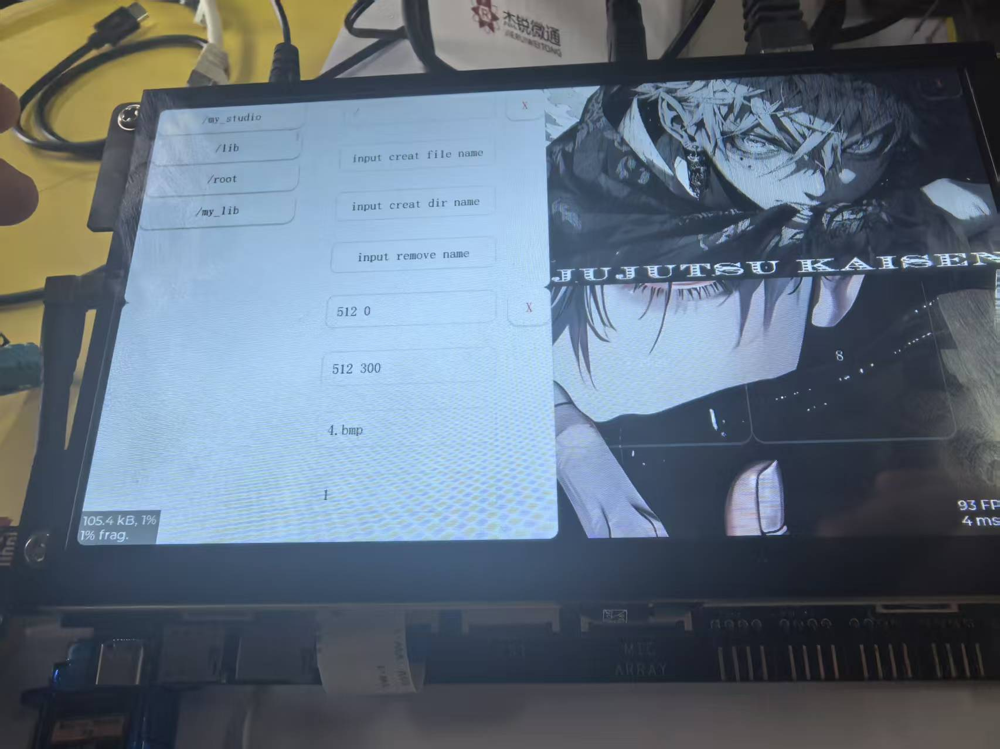
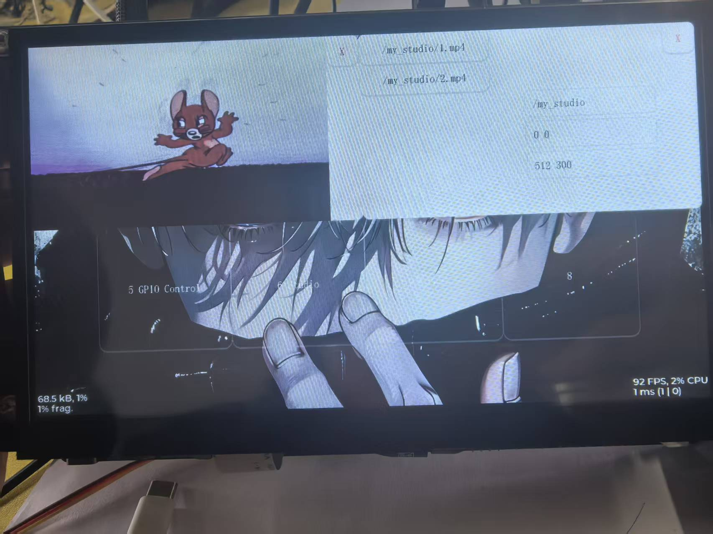
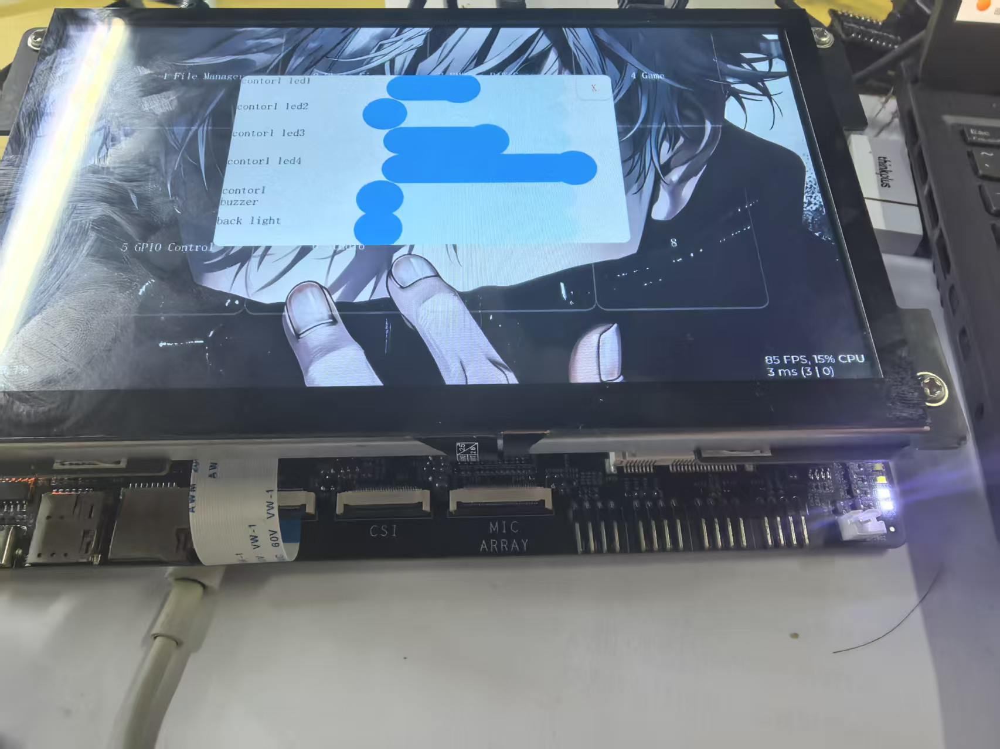
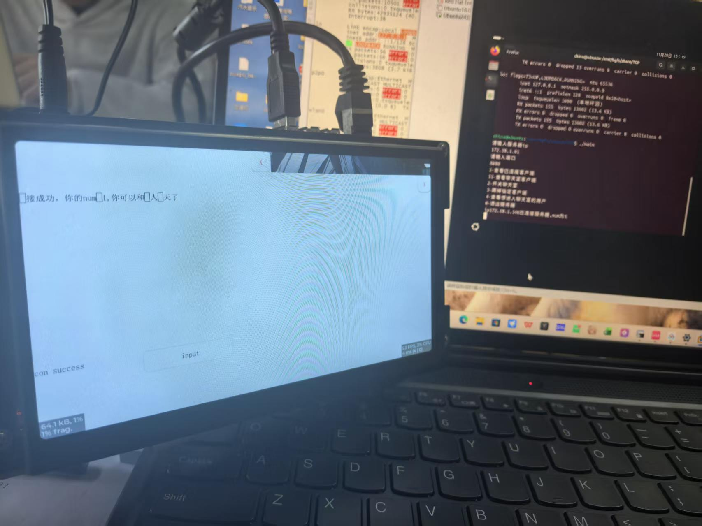

# rk3568-lvgl-embedded-desktop

> 基于 RK3568 开发板与 LVGL 框架的 **嵌入式综合桌面系统**。
>
> 项目涵盖 **GUI 交互、Linux 系统编程、文件 IO、进程/线程通信、网络 Socket、外设控制**。
> 全部代码由纯 C 语言编写，**通过 Framebuffer 直接驱动屏幕，通过 evdev 处理触摸**，未使用 Qt 等重量级框架。

---

## 📌 项目背景

在掌握了 Linux 系统调用（文件 I/O、`mmap`、`ioctl`）与 RKNN 边缘 AI 部署后，我意识到嵌入式开发不仅仅是对硬件的直接控制，如何构建稳定、交互友好的 **边缘端人机界面（HMI）** 同样重要。

本项目基于 `LVGL` 图形库，从零搭建了一个类平板的桌面系统。**我的目的是通过一个大一统的 C 工程，将 Linux 下的进程、线程、网络、文件系统、设备节点（GPIO、Framebuffer）等知识点全部串联起来**，检验自己对复杂工程与系统资源的调度能力。

> 👨‍💻 求职意向：**嵌入式软件工程师**。

---

## 🎯 效果展示

<table border="0" cellspacing="10" cellpadding="0">
  <tr>
    <td align="center" valign="top">
      <b>🔐 登录界面 & 虚拟键盘</b><br>
      
    </td>
    <td align="center" valign="top">
      <b>📁 文件查找 & 🛠️ 图片转化</b><br>
      
    </td>
  </tr>
  <tr>
    <td align="center" valign="top">
      <b>🖼️ 图片播放器 & 壁纸设置</b><br>
      
    </td>
    <td align="center" valign="top">
      <b>🎬 视频播放</b><br>
      
    </td>
  </tr>
  <tr>
    <td align="center" valign="top">
      <b>🎛️ GPIO 控制 & PWM 调光</b><br>
      
    </td>
    <td align="center" valign="top">
      <b>💬 局域网聊天 & 文件传输</b><br>
      
    </td>
  </tr>
</table>

*(注：图片中为自定义虚拟键盘、基于 Canvas 渲染的媒体应用、sysfs 控制外设、以及基于 Socket 的聊天界面)*

---

## 🧱 功能模块 & 技术栈

整个系统共有 7 个 App，底部全局挂载了一个可滑动的虚拟键盘，通过点击文本框自动获取焦点。

### 1. 📁 File Manager（文件管理器）
- **系统编程**：使用 `opendir` / `readdir` 遍历目录，`mkdir` 创建目录，`fopen` / `remove` 创建与删除文件。
- **UI 交互**：动态创建 LVGL 按钮列表，通过回调函数递归进入子目录，使用 `lv_label` 的长文本滚动模式展示路径。

### 2. 🖼️ Photo Viewer & 3. 🛠️ BMP to RAW Converter
- **图片解析**：手动解析 BMP 文件头（`#pragma pack(push,1)` 结构体对齐），处理 BMP 行对齐（4字节补齐）与自下而上/自上而下的高度扫描。
- **像素处理**：编写 `bmp_raw` 转换函数，实现 `BGR888 -> ARGB8888` 的转换，并支持图像裁剪与缩放。
- **Canvas 渲染**：利用 LVGL 的 `lv_canvas` 组件，直接操作像素缓冲区，将 RAW 数据渲染到屏幕上。

### 4. 🎮 Game（双人射击小游戏）
- **游戏循环**：通过 `lv_timer` 实现帧刷新，处理子弹移动、物理碰撞检测（矩形相交）与胜负判定。
- **状态机**：使用状态机管理角色朝向（左/右）、子弹发射状态与有效计数，支持触摸按键长按连续移动。

### 5. 🎛️ GPIO Control (LED/Buzzer/Backlight)
- **sysfs 操作**：通过 `/sys/class/gpio` 路径，使用 `write` 系统调用控制 4 个 LED 与 1 个蜂鸣器。
- **软件 PWM 调光**：利用 LVGL 定时器，以 10ms 为周期，通过占空比算法（0-20级）在应用层模拟 PWM 方波，实现 LED 呼吸灯与蜂鸣器音量控制。
- **背光调节**：通过写入 `/sys/class/backlight` 控制屏幕亮度。

### 6. 🎬 Studio（媒体播放器）
- **多进程控制**：使用 `fork` 派生子进程，通过 `execlp` 调用 `mplayer64` 播放视频，并指定 `-vo fbdev2` 覆盖在 Framebuffer 上。
- **IPC 管道通信**：父进程通过 `mkfifo` 创建命名管道，通过非阻塞 `write` 向管道发送指令，实现视频的暂停、快进与快退。

### 7. 💬 Chat（局域网聊天与文件传输）
- **网络通信**：使用 TCP `socket`、`inet_pton` 建立客户端连接，配合 `poll` 实现非阻塞的数据监听。
- **多线程接收**：使用 `pthread_create` 分离出文件接收线程，防止大文件传输阻塞 UI 主线程。
- **零拷贝文件接收**：接收文件时，使用 `mmap` 将目标文件直接映射到虚拟内存，将收到的网络数据 `memcpy` 到映射区，显著减少大文件写入的 I/O 开销。

---

## 🚀 编译与运行

### 依赖环境
- **硬件**：RK3568 (或任意支持 Linux Framebuffer 的开发板)
- **库依赖**：LVGL 8.x / 9.x
- **系统要求**：开启了 `/dev/fb0` 与 `/dev/input/eventX`

### 编译（参考）
```bash
# 将 LVGL 源码与本文件一起编译
aarch64-linux-gnu-gcc main.c lvgl/src/*.c \
    -I./lvgl \
    -lpthread \
    -o lvgl_desktop
```

### 板端运行
```bash
./lvgl_desktop
```

---

## 🧠 工程重难点与踩坑总结

### 1. 内存泄漏与 Canvas 释放
在 C 语言中使用 LVGL 的 Canvas 时，需要使用 `malloc` 申请像素缓冲区交由 LVGL 渲染。我在每个 `canvas` 对象上挂载了 `LV_EVENT_DELETE` 事件，当 UI 控件被销毁时，**确保配套的堆内存被 `free` 释放**，防止长时间运行后发生 OOM。

### 2. 多进程与 Framebuffer 冲突
调用外部 `mplayer` 播放视频时，它是直接往 `/dev/fb0` 写数据的，这会**覆盖掉 LVGL 正在渲染的 UI 层**。我的解决思路是：在视频播放时，关闭 LVGL 的局部刷新，将 UI 层设置为透明，或者使用分屏大小计算，利用 `-geometry` 参数让 mplayer 只渲染在屏幕的特定区域。

### 3. 网络接收的粘包与半包
在局域网传输文件时，TCP 传输不可靠边界。我通过在协议包头加入 `$ 文件大小` 标识，接收端根据已接收字节数与目标大小比对，配合 `mmap` 缓冲区偏移量进行精准续传，并使用 `poll` 超时机制处理断连。

### 4. 虚拟键盘的事件焦点劫持
为了让全局虚拟键盘生效，我采用了**动态焦点**方案。用户点击 TextArea 时，触发 `CLICKED` 回调，将全局变量 `curtest_printf` 指向该 TextArea。点击键盘按键时，直接向这个指针发送 `LV_EVENT_ADD_TEXT` 事件，以此实现输入功能。

---

## 📚 个人总结与展望

通过这个综合项目，我对**面向对象的 C 语言工程化**有了深刻体会：
1. 纯 C 环境下，利用结构体指针和回调函数（Callback）可以极其灵活地实现事件驱动（LVGL 的设计哲学）。
2. 嵌入式 UI 并不是“花里胡哨”的渲染，**底层的系统资源调度**（内存分配、进程句柄、文件描述符、Socket 句柄）才是整个系统稳定运行的基石。
3. 在未来的学习中，我计划进一步**将部分耗时操作交由硬件加速**，例如利用 RGA 进行图像格式转换，利用 DMA 进行数据搬运，并尝试引入 FreeRTOS 或 RT-Thread，将这套 UI 移植到实时性更强的 MCU 平台上。

如果你也是嵌入式软件开发的求职者或爱好者，欢迎通过 Issue 与交流，也恳请各位前辈对我的代码提出 Review 与指正！
